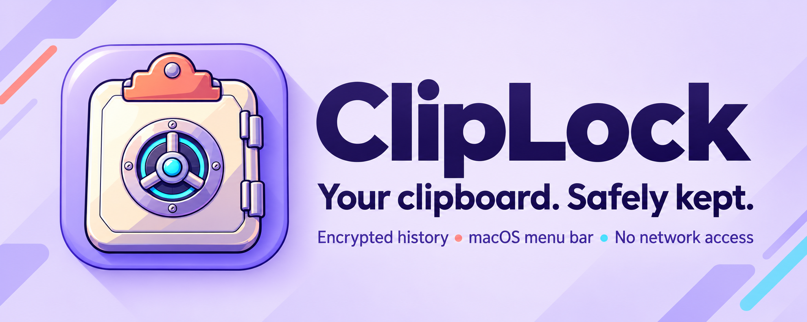
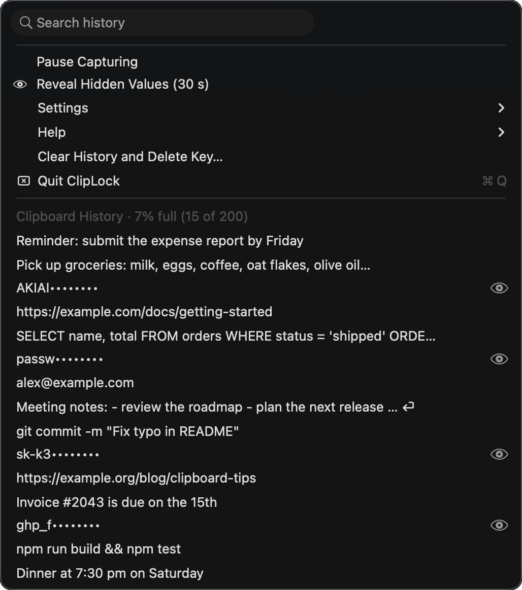
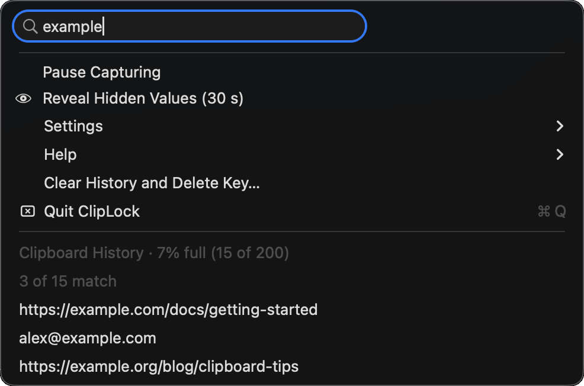
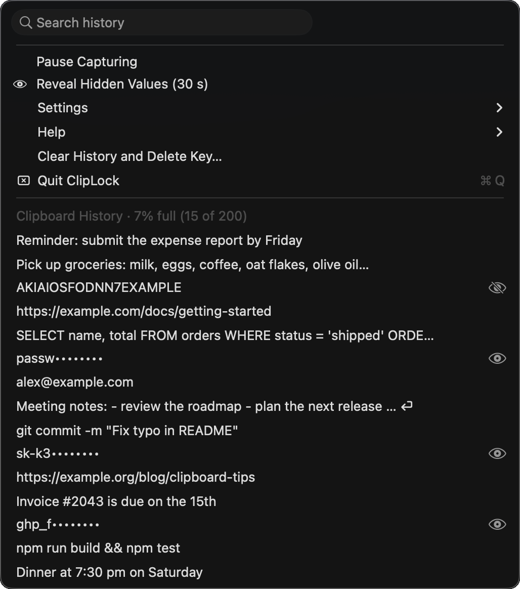

<h1 align="center">
  
</h1>

A lightweight macOS menu bar clipboard history app. Copies are saved encrypted (AES-256-GCM) with the key in your Keychain, and one menu item clears everything.

It is for people who copy passwords, API keys and tokens all day and would rather not leave them sitting in plain text.

Click the ClipLock icon in the menu bar to see what you copied recently, newest first. Click an item to copy it back. Click the search box at the top and type to filter the list as you type. A cursor and an outline show it is ready. Press Return to copy the first match. Settings such as Pause and the secret options keep the menu open when you click them.

## Screenshots

<table>
  <tr>
    <td align="center" width="33%"></td>
    <td align="center" width="33%"></td>
    <td align="center" width="33%"></td>
  </tr>
  <tr>
    <td align="center"><sub>Your history, newest first. Secrets are partly hidden.</sub></td>
    <td align="center"><sub>Click the search box and type to filter.</sub></td>
    <td align="center"><sub>The eye shows or hides one entry.</sub></td>
  </tr>
</table>

<sub>All entries shown are made-up examples.</sub>

## Features

- **Encrypted at rest.** History is stored with AES-256-GCM. The key is kept in your Keychain (this device only), never in a file.
- **Clear on demand.** *Clear History and Delete Key…* deletes the history file and the encryption key, so nothing old can be decrypted.
- **Handles secrets your way.** Items marked as concealed by password managers are never saved. For private keys, API keys, tokens and `password=…` text that ClipLock recognises ("likely secrets"), you choose one of three behaviours from the menu:

  | Menu setting | What happens |
  |---|---|
  | **Save, Hide Part of Likely Secrets** (default) | Saved encrypted. The menu shows only the first 5 characters, then `••••••••`. |
  | **Skip Likely Secrets (don't save)** | Not saved at all. |
  | Neither ticked | Saved and shown in full. |

  The two settings cannot both be on. Each hidden entry has an **eye** button: click it to show or hide just that entry, right in the menu. **Reveal Hidden Values** at the top shows all hidden entries for 30 seconds. Clicking the entry itself copies the full value.
- **Launch at Login.** Turn it on from the menu so ClipLock starts when your Mac does.
- **Built-in Help.** The *Help* submenu explains the `…` and `⏎` marks and what is and is not saved.
- **Pause anytime.** Stop capturing without losing what is already saved.
- **Light on the system.** It checks the clipboard about twice a second, saves in the background, and ignores copies over 200 KB.
- **No network code.** The app does not talk to the internet. The source is one short file, so you can check.

Text only. Up to 200 items are kept, and the oldest are dropped first.

## Install

Requires macOS 13 or later. Runs on Apple Silicon and Intel.

1. Download the latest `ClipLock-<version>.dmg` from [Releases](../../releases).
2. Open it and drag **ClipLock** into **Applications**.
3. Open ClipLock. It lives in the menu bar and has no Dock icon. macOS will block the first launch, so follow [First launch warning](#first-launch-warning) below.
4. On newer macOS versions (15.4 and later), macOS may ask to allow ClipLock to paste from other apps. Click **Allow**. Without this it cannot read the clipboard (System Settings → Privacy & Security → Paste from Other Apps).
5. If macOS asks whether ClipLock may use its key in your Keychain, enter your password and click **Always Allow**. The icon appears in the menu bar straight away, but history starts once you answer. Because the app is not signed with an Apple Developer ID, macOS may ask again after you install an update.

### First launch warning

ClipLock is not notarized by Apple, so the first time you open it macOS says *"Apple could not verify ClipLock is free of malware"*. Click **Done** (not *Move to Trash*), then allow it once:

1. Open **System Settings → Privacy & Security** and scroll down to the Security section.
2. Next to *"ClipLock" was blocked*, click **Open Anyway** and enter your password.
3. Open ClipLock again and confirm.

On macOS 14 and earlier, right-clicking the app and choosing **Open** also works.

Only do this for a download from this repository's Releases page. The command below turns off the macOS check for this one app, so run it only after you have verified the download (see next section):

```bash
xattr -dr com.apple.quarantine /Applications/ClipLock.app
```

This only needs to be done once per install.

### Verify your download

Each release includes a `.sha256` file that lists the `.dmg` and the `.zip`. Put it in the same folder as the file you downloaded and check just that file:

```bash
cd ~/Downloads && grep '\.dmg' ClipLock-<version>.sha256 | shasum -a 256 -c
```

It should print `OK`. (For the zip, use `grep '\.zip'` instead.) This catches a damaged or incomplete download. It cannot prove who built the file, because the checksum is published next to the download, so only download from this repository.

## Good to know

- **Hidden is not deleted.** In *Hide Part* mode a likely secret is still stored, encrypted, until you clear the history, and clicking its entry copies the full value. Hiding protects against someone glancing at your screen, not against someone using your Mac with your login password. Choose *Skip* if you would rather never store them.
- **Secrets.** Saved text is encrypted on disk, but the menu shows ordinary entries as plain text, so anyone looking at your screen can read them. Secret detection is a best-effort filter. It recognises well-known key and token formats and long random-looking strings, but it cannot recognise an ordinary short password. Use **Pause Capturing** before copying one.
- **Launch at Login** uses the macOS Login Items list. macOS may ask you to approve ClipLock in System Settings → General → Login Items the first time. It works best when the app is in your Applications folder.
- **History does not expire.** Items stay until they are pushed out by newer ones or you clear the history.
- **Screen Sharing and Universal Clipboard.** Text copied on one Mac and synced to another is saved on the other Mac too, and it arrives without the "concealed" flag that password managers set. Use **Pause Capturing** before copying anything sensitive.
- **Memory.** Clearing deletes the saved data and the key, but macOS does not let an app reliably overwrite its own memory, so text may linger in RAM until the app quits.
- **Damaged or unreadable history** is moved aside (`history.enc.unreadable-…`) instead of being overwritten.
- **Not sandboxed.** ClipLock is signed with the hardened runtime but is not an App Sandbox app. It has no network code, but that comes from the source, not from a sandbox. Its Keychain item is a regular login Keychain item, so other apps running as you can ask for it, and macOS will prompt you.
- **Backups.** The history folder is excluded from Time Machine. The encryption key lives in your login Keychain, which is backed up, so a backup of the whole Mac still contains both.
- **Menu previews** show the first 60 characters. A `…` means the entry is longer and `⏎` means it has several lines. Clicking an entry copies all of it.

Data lives in `~/Library/Application Support/ClipLock/`.

## Why you can trust it, and its limits

- The whole app is one readable Swift file (`Sources/ClipLock/ClipLock.swift`) with no third-party code in it.
- There is no network code. History never leaves your Mac.
- The release build runs on GitHub from this source. Its GitHub Actions are pinned to exact commits and its one build dependency is pinned with hashes.
- The code is MIT licensed and reviewed with static analysis and manual security reviews, but it has not had an outside audit.

Limits: text only, no sync between Macs, no snippets or hot key, not notarized by Apple, and ordinary entries are shown as plain text in the menu.

To report a vulnerability, see [SECURITY.md](SECURITY.md).

## Build from source

You need macOS with the Xcode command line tools (`xcode-select --install`).

```bash
scripts/build.sh              # builds build/ClipLock.app (universal)
scripts/package.sh            # builds the .dmg, .zip and .sha256 in build/
```

`package.sh` needs `python3` and an internet connection, because it installs the pinned, hash-checked [dmgbuild](https://github.com/dmgbuild/dmgbuild) (and its two dependencies, `ds_store` and `mac_alias`, all MIT licensed) into `build/venv`. These are build tools only and are not shipped in the app.

Set `VERSION=1.2.3` to stamp a version number. Without it the build is labelled `0.0.0-dev`.

## Releases

GitHub builds the installer and publishes it as a release. Either:

- open the **Actions** tab, choose **Release**, click **Run workflow**, and type a version such as `1.0.0`; or
- push a tag:

```bash
git tag v1.0.0
git push origin v1.0.0
```

Only the maintainer can start a release.

Every push and pull request also runs a build (`.github/workflows/ci.yml`) and attaches the installer as a downloadable artifact.

Releases are ad-hoc signed only. Notarizing them needs a paid Apple Developer account.

## License

The source code and documentation are released under the MIT licence. See [LICENSE](LICENSE).

The app icon and the README banner (`Resources/AppIcon.png`, `Resources/AppIcon.icns` and `docs/readme-banner.png`) are © 2026 ed0157, all rights reserved. They are **not** covered by the MIT licence (see [NOTICE.md](NOTICE.md)). Please do not reuse them without permission.
